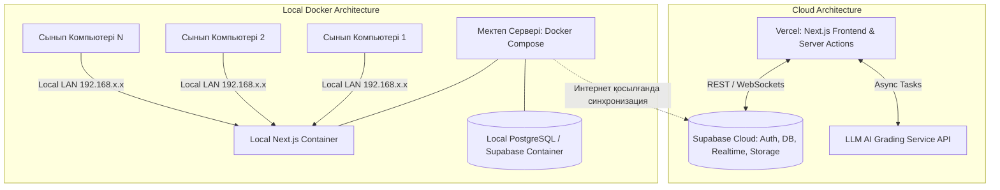
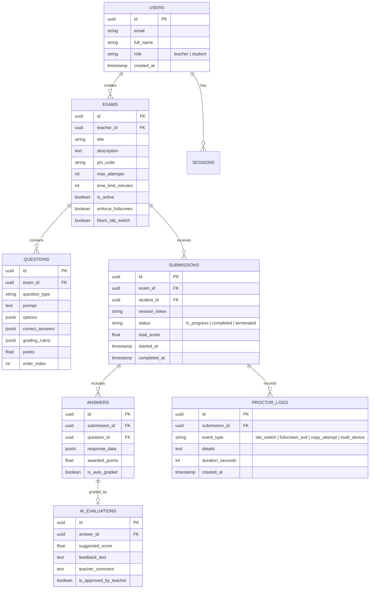

# Жоба архитектурасы (Architecture)

Бұл құжат `my-forms` (Secure Smart Exam & Assessment Platform) платформасының жүйелік архитектурасын, гибридті жұмыс істеу режимін және модульдер байланысын сипаттайды.

---

## 1. Жүйенің гибридті архитектуралық сұлбасы

Платформа **Онлайн (Бұлттық)** және **Оффлайн (Локальді сыныптық сервер)** режимінде жұмыс істей алады:

---

## 2. Негізгі модульдер мен сервистер

### 2.1. Proctoring Engine (Прокторинг қозғалтқышы)
* **Session Manager**: Оқушының активті құрылғысын бақылау, параллель кірулерді болдырмау.
* **Focus & Event Tracker**: Клиенттік браузердің `visibilitychange`, `blur`, `fullscreenchange` оқиғаларын бақылап, бұзушылық журналдарын тіркейді.
* **Realtime Broadcast**: Supabase Realtime (WebSockets) арқылы мұғалімнің мониторына нақты уақытта ескертулер мен күйлерді жіберіп отырады.

### 2.2. Form & Question Engine
* **Dynamic Form Renderer**: Мектепке қажетті 9 түрлі сұрақ типін және формулаларды (KaTeX / LaTeX) визуализациялау.
* **Drag-and-Drop Builder**: Сұрақтар блогын құрастыру кезінде ыңғайлы сұрыптау (`@dnd-kit` немесе ұқсас заманауи кітапхана).

### 2.3. AI Grading Agent (Жасанды Интеллектпен бағалау)
* **Prompt Engine & Rubrics**: Мұғалімнің критерийлері бойынша ашық жауаптар мен эсселерді сараптау.
* **Evaluation Pipeline**: Балл ұсыну, оқушыға конструктивті кері байланыс және плагиат қаупі туралы мұғалімге есеп беру.

### 2.4. Integration & Export Service
* Google Sheets API арқылы нәтижелерді онлайн кестеге экспорттау.
* Excel (.xlsx), CSV және баға ведомосының PDF генераторы.

---

## 3. Дерекқор құрылымы (Database Schema Outline)

